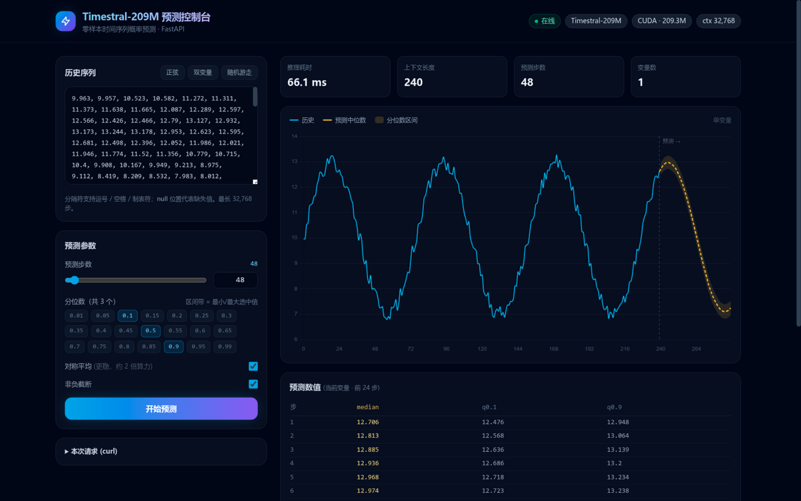
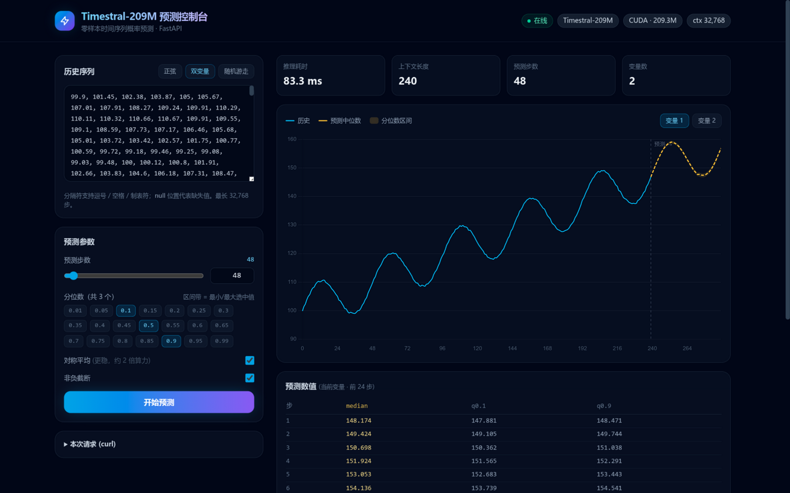
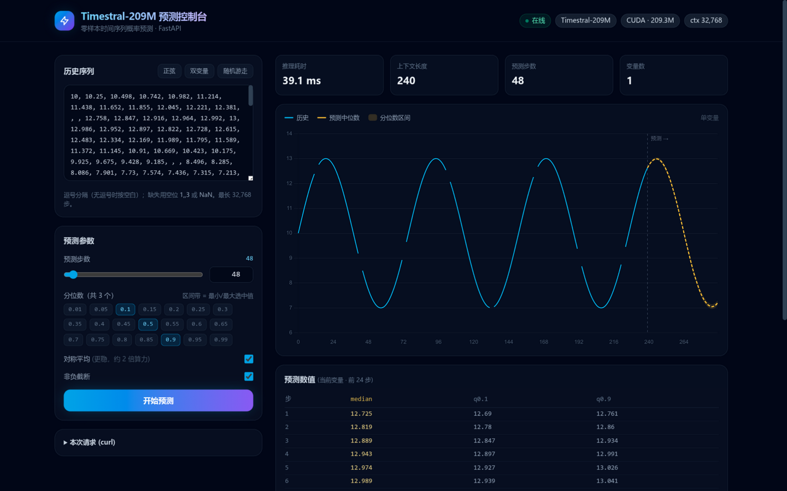

# Timestral-209M 预测服务 (FastAPI)

把本地模型 `/home/feifei/develop/models/Timestral-209M`（Mistral AI 时间序列基础模型，
209M 参数，零样本概率预测）封装为 HTTP 服务。模型分析见 [ANALYSIS.md](ANALYSIS.md)。

## 快速开始

```bash
cd /home/feifei/develop/app/Timestral
# 环境已就绪: .venv (torch 2.14.1+cu130 + timestral + fastapi)
.venv/bin/uvicorn app.main:app --host 0.0.0.0 --port 8000
# 交互文档: http://localhost:8000/docs
```

环境变量：`TIMESTRAL_MODEL_PATH`（模型目录）、`TIMESTRAL_DEVICE`（auto/cuda/cpu）、
`TIMESTRAL_MAX_HORIZON`（单请求最大预测步数，默认 4096）。

## API 一览

| 方法 | 路径 | 说明 |
|---|---|---|
| GET | `/` | **Web 预测控制台**（Tailwind + Chart.js，本地化依赖无需外网） |
| GET | `/health` | 模型/设备/显存/分位数节点等状态 |
| POST | `/forecast` | 单序列预测（单变量或多变量，支持缺失值、协变量） |
| POST | `/forecast/batch` | 多条序列批量预测，形状相同的自动合并成 batch |
| GET | `/docs` | Swagger 交互文档 |

### Web 控制台

浏览器打开服务根地址即可：左侧粘贴序列（逗号分隔，空位 `1,,3` 或 `NaN` 表示缺失；
无逗号时按空白分隔；每行一个变量即多变量）、拖动预测步数、勾选分位数，右侧绘制
历史曲线 + 中位数预测 + 分位数区间带，可切换变量、查看数值表和对应的 curl 请求。
Ctrl/Cmd+Enter 快捷发送。



多变量联合预测，右上角切换变量：



缺失值（`1,,3` 或 `NaN`）在历史曲线上显示为断线，模型照常预测：



### 请求要点

- `series`：一维 `list[float]` = 单变量；二维 `list[list[float]]` = 多变量（每行一个变体，联合预测）。
  上限 32,768 步。**`null` 表示缺失**。
- `prediction_length`：预测步数；>1024 时模型内部自动分块滚动预测。
- `quantiles`：要返回的分位数，取值限于模型的 21 个节点（0.01–0.99，见 `/health`），默认 `[0.1, 0.5, 0.9]`。
- 协变量（可选）：`past_covariates (C,T)`、`known_covariates (C,T+H)`，及对应的 categorical 版本。
- 选项：`symmetric_averaging`（默认 true，约 2 倍算力换更稳结果）、`clip_nonnegative`（默认 true）。

### 示例

```bash
curl -s http://localhost:8000/forecast -H 'Content-Type: application/json' -d '{
  "series": [1.2, null, 3.1, 4.0, 3.8, 5.5, 6.1, 6.9],
  "prediction_length": 8,
  "quantiles": [0.1, 0.5, 0.9]
}'
```

响应（每个变体一份 `median` + 各分位数的整条预测序列；NaN 统一输出为 `null`）：

```json
{
  "prediction_length": 8,
  "quantile_levels": [0.1, 0.5, 0.9],
  "forecast": {
    "context_length": 8, "num_variates": 1,
    "variates": [
      {"variate_index": 0,
       "median": [7.1, 7.3, "..."],
       "quantiles": {"0.1": ["..."], "0.5": ["..."], "0.9": ["..."]}}
    ]
  },
  "inference_ms": 42.5,
  "model": "Timestral-209M"
}
```

多变量示例（2 个变体，第二个变体带缺失 + 观测掩码）：

```bash
curl -s http://localhost:8000/forecast -H 'Content-Type: application/json' -d '{
  "series": [[1,2,3,4,5,6,7,8], [10,11,null,13,14,15,16,17]],
  "observation_mask": [[true,true,true,true,true,true,true,true],[true,true,true,true,true,true,false,false]],
  "prediction_length": 12
}'
```

Python 演示客户端：`.venv/bin/python scripts/demo_client.py [host] [port]`

## 验证记录（RTX 5090 D）

- `/health`：209.3M 参数、CUDA、常驻显存 ~853 MB。
- 单变量（含 null 缺失）H=48：~57 ms；多变量 V=2 H=24：~48 ms；批量 3 条：~68 ms。
- 已知协变量小时周期序列：预测准确延续 0→23 日内周期。
- 与直接调库对比：median 最大绝对差 ~2e-3（服务端开启 TF32 加速所致）。
- 错误处理：非法分位数 / 空序列 / 锯齿数组 / 协变量长度不符 → 400 + 中文原因。

## 并发说明

单模型单卡实例，推理在进程内用锁串行化；请用 **单 worker** 启动
（多 worker 会各加载一份模型占多份显存）。批量接口可将多条序列合并成一次前向，
吞吐敏感的场景建议客户端聚合后调 `/forecast/batch`。

## 许可

模型权重遵循 Mistral 的 Modified MIT 许可（见模型目录 LICENSE）。
